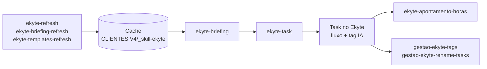

# Kit de Skills do Ekyte

São 8 skills para criar, briefar e manter tarefas no Ekyte usando o agente (Claude Code, Codex ou outros compatíveis), no fluxo **Projeto Prisma** da Colli&Co. Cada skill aparece em três cópias, uma para cada ferramenta: `.claude`, `.agents` e `.codex`.

## As skills

| Skill | O que faz |
|---|---|
| `ekyte-task` | Skill central: cria a task (cliente → projeto → tipo → SLA → fluxo), mostra o preview, cria, valida as fases e aplica a tag IA |
| `ekyte-briefing` | Chamada pela `/ekyte-task`: escreve o HTML do briefing a partir do template da sigla + NotebookLM; tem modo 5W1H |
| `ekyte-apontamento-horas` | Aponta horas pela API interna (tem script Python), checando duplicidade |
| `gestao-ekyte-tags` | Aplica tags em lote (rotina + semana, ou tipo de entregável), juntando com as que já existem |
| `gestao-ekyte-rename-tasks` | Renomeia tasks em lote (localizar e substituir) |
| `ekyte-refresh` | Atualiza o cache de workspaces, projetos do trimestre, tipos e fluxos |
| `ekyte-briefing-refresh` | Atualiza `drives.md` e `backups-crm.md` |
| `ekyte-templates-refresh` | Cria ou ajusta os templates de briefing por sigla |



## Instalação

1. Clone o repositório e copie as pastas `.claude/`, `.agents/`, `.codex/` e `CLIENTES V4/` para a raiz do seu workspace. As skills leem o cache pelo caminho `CLIENTES V4/_skill-ekyte/`, a partir dessa raiz.

   ```bash
   git clone https://github.com/fabiojoseaiello-alt/ekyte-skills-kit.git
   ```

2. Configure o **MCP oficial do Ekyte** ([documentação](https://developers.ekyte.com/docs/mcp/)). Em [app.ekyte.com/profile](https://app.ekyte.com/profile), abra **Meu Perfil → Integrações MCP** e copie a URL, que já vem com o seu token. Depois cadastre no agente:

   ```bash
   # Claude Code
   claude mcp add --transport http ekyte "https://api.ekyte.com/mcp?token=<SEU_TOKEN>"
   ```

   ```toml
   # Codex (~/.codex/config.toml)
   [mcp_servers.ekyte]
   url = "https://api.ekyte.com/mcp?token=<SEU_TOKEN>"
   ```

   A URL inteira é um segredo: tudo o que for feito com ela fica registrado no seu usuário do Ekyte. Se ela vazar, use **Gerar URL** (cria um token novo e invalida o antigo) ou **Revogar URL**. Algumas listagens do MCP têm limite de registros (`list_tasks` 200, `list_projects` 75, `list_time_trackings` 400), e apontamento de horas pelo MCP precisa de horário de início e de fim.

3. Configure o **token REST**, que é usado para ativar tasks, apontar horas e como alternativa quando o MCP falha. Copie `CLIENTES V4/_skill-ekyte/.env.example` para `.env` na mesma pasta e cole o seu JWT; o passo a passo está no próprio arquivo. O `.env` está no `.gitignore`, então nunca suba esse arquivo.

4. **Preencha o cache com os seus dados.** O kit vem com os tipos de tarefa, fluxos, SLA e templates da Colli&Co, mas sem workspaces nem projetos. Rode `/ekyte-refresh`, diga quais clientes você atende e troque `<seu-email>` em `cache.md` pelo seu e-mail do Ekyte. Rode também `/ekyte-briefing-refresh` para cadastrar os Drives e as planilhas de backup de CRM.

## O que vem no cache

| Arquivo | Conteúdo | Já vem preenchido? |
|---|---|---|
| `cache.md` | Defaults, workspaces, projetos, tipos de tarefa (Prisma e legado) | Só os tipos de tarefa |
| `flows.md`, `flows-prisma.md` | Fases de cada tipo e `phaseId` | Sim |
| `sla.md` | Prazo por sigla | Sim |
| `briefing-templates/` | Templates por sigla (AN, CA, CRM, LP, PC, RV, 5W1H) | Sim |
| `drives.md`, `backups-crm.md` | Drive e planilha de backup de cada cliente | Não |
| `_publicos-cache-template.md` | Formato do cache de público por cliente | Sim |

## Dependências opcionais

- A `ekyte-briefing` consulta o NotebookLM do cliente pela skill `cs-notebooklm-consulta-cliente` e lê o `CLAUDE.md` da pasta do cliente (`clientes/<cliente>/CLAUDE.md` no texto da skill), que precisa ter o bloco `## NotebookLM`. Sem isso, ela pergunta antes de seguir sem o NotebookLM.
- O script da `ekyte-apontamento-horas` precisa de Python 3.10 ou mais novo.

## Antes de usar

- O texto das skills foi escrito para o uso de uma pessoa: onde aparece "o Fabio", leia "você". Os clientes dos exemplos têm nomes genéricos (Cliente Alfa, Beta, Gama…).
- O kit cria tarefas de verdade no Ekyte. A `/ekyte-task` sempre mostra um preview e espera a sua confirmação antes de criar.
